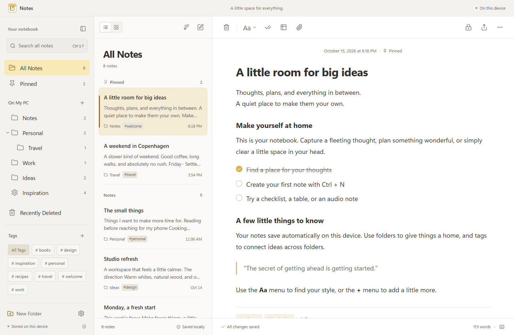
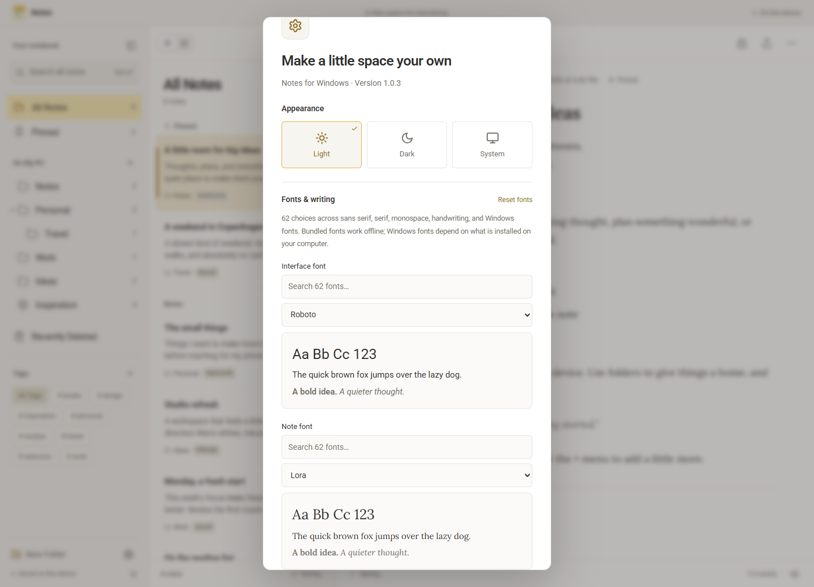
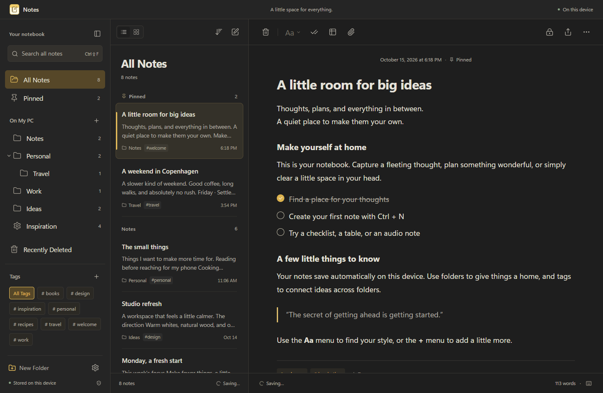

# Notes for Windows

A local-first desktop notebook for Windows. A familiar three-pane layout brings folders, a note list, and a calm writing surface together, with readable typography and your choice of fonts.

**[Download the latest Windows release](https://github.com/Vishaljani21/notes-for-windows/releases/latest)** · [Report an issue](https://github.com/Vishaljani21/notes-for-windows/issues) · [Changelog](CHANGELOG.md)

This independent open-source application is inspired by Apple Notes. It is not affiliated with, endorsed by, or connected to Apple, and does not connect to iCloud.



## Install

1. Open the [latest release](https://github.com/Vishaljani21/notes-for-windows/releases/latest).
2. Download `Notes-for-Windows-Setup-<version>.exe` and run it.
3. Choose an installation folder. The installer adds a desktop shortcut and Start menu entry.

Releases target **64-bit Windows**. You do not need Node.js to use the installed app. The installer is currently **unsigned**, so Windows may display an unknown-publisher or SmartScreen warning. Only download releases from this repository. Release assets include `SHA256SUMS.txt` for checking downloaded files with `Get-FileHash`.

Updates are installed manually from Releases. Back up your notebook from Settings before upgrading.

## Features

- **Make it comfortable:** light, dark, and system appearance; list and gallery views; adjustable interface and editor text sizes; font choices in Settings, including bundled fonts that work offline and Windows system fonts.
- **Write and format:** rich text, headings, emphasis, highlights, quotes, code blocks, checklists, lists, tables, collapsible sections, undo/redo, and spell checking.
- **Keep things organized:** folders and subfolders, drag notes into folders, pins, tags, tag-based Smart Folders, search, and links between notes by typing `>>`.
- **Capture more:** images, file attachments, microphone recordings, audio import, English speech transcription, and English text recognition from imported images or camera photos.
- **Work with your words:** a calculation dialog and a local extractive summary that selects sentences from the note.
- **Keep control of your data:** automatic local saving, Recently Deleted with restore, JSON notebook backups and restores, plain text/HTML note export, and print-to-PDF through Windows.
- **Lock private content:** password-encrypted note content, tags, and attachments. Titles, folder membership, and timestamps remain visible.

Choose **Settings → Fonts & writing** to preview and apply any of **62 font choices**, including **48 bundled open-source families**. Select an **Interface font** and a separate **Note font**, or let notes follow the interface. Search by name or category and use **Reset fonts** to return to Segoe UI. Generic sans-serif, serif, and monospace choices use your system's matching fonts. Windows-specific choices may fall back if not installed; bundled fonts work offline. The bundled Latin character sets use system fallbacks for scripts they do not contain. Both font preferences are saved on your device.





Screenshots show the app's included fictional sample notes.

## Data and privacy

Your notebook stays on your device unless you export it. The desktop app saves `notes-data.json` and a recovery copy, `notes-data.json.bak`, in Electron's user data directory, normally `%APPDATA%\notes-for-windows\`. Saving writes a temporary file before replacing the main library. Browser development preview data is stored separately in IndexedDB.

Speech transcription downloads the [Whisper Tiny English model](https://huggingface.co/onnx-community/whisper-tiny.en) on first use. OCR downloads English language data on first use. Downloads contact the relevant model hosts/CDNs; audio and document images are processed locally. A firewall or unavailable model host can prevent these features from starting. Original media can still be kept in a note.

Locked content uses AES-256-GCM with a PBKDF2-derived key. Passwords are held in memory while notes are unlocked. Quit the app or choose **Close this locked note** to close a lock. There is no password recovery. Locking a note does not securely erase older disk blocks or previously exported backups. Keep regular backups in another location.

## Current limitations

- No iCloud, account sync, shared notes, or collaboration.
- No Apple Intelligence, handwriting recognition, Apple Pencil, or Windows Quick Notes integration.
- Math uses a calculation dialog; it does not solve handwritten or inline equations automatically.
- OCR extracts text from photos; it does not import searchable PDFs, automatically detect document edges, or combine scans into multipage PDFs.
- Smart Folders currently match one tag. Speech transcription and OCR initially support English.
- Camera/microphone access depends on device hardware and Windows permissions. Automated media tests use imported fixtures.
- This is an early desktop app. Back up important notes; signed installers and automatic updates are not available yet.

## Develop

Use **Node.js 24** and npm on Windows. Clone this repository, then run:

```powershell
npm ci
npx --no-install install-electron
npm start
```

The separate Electron installation command downloads the desktop runtime if it is missing. `npm start` builds the renderer and opens Electron. To work on the renderer in a browser, run `npm run dev` and open `http://127.0.0.1:5173/`.

```powershell
# Unit tests and production renderer build
npm test
npm run build

# Browser workflows (Playwright starts the dev server when needed)
npx playwright install chromium
npm run test:ui

# Real Electron persistence/encryption smoke test; requires the build above
node scripts/desktop-smoke.cjs

# Isolated recovery, corrupt-library preservation, and single-instance checks
node scripts/release-safety-smoke.cjs

# Optional media smoke test; downloads models and uses test fixtures
node scripts/desktop-smoke.cjs --media

# Build an unsigned Windows x64 installer without publishing
npm run dist -- --publish never
```

Output goes to `dist/` for the renderer and `release/` for the Windows installer. CI runs unit, browser, Electron, and recovery/single-instance checks on Windows. Desktop checks use isolated test notebooks. CI does not exercise physical camera/microphone hardware or the optional model downloads. The tagged release workflow repeats checks, builds an unsigned installer, computes SHA-256 checksums, and uploads a GitHub release.

Built with React, Tiptap, Electron, Transformers.js, Tesseract.js, and mathjs. The renderer has no direct Node.js access; a context-isolated preload exposes specific storage, export, window, and validated external-link actions.

## Contribute and license

Bug reports, accessibility improvements, tests, and focused pull requests are welcome. See [CONTRIBUTING.md](CONTRIBUTING.md).

Original project source is available under the [MIT License](LICENSE), copyright 2026 Vishaljani21. Dependencies, bundled fonts, downloaded models, and Electron/Chromium retain their own licenses and notices; they are not relicensed under this project's MIT license. See [third-party licensing notes](docs/third-party-licenses.md).
